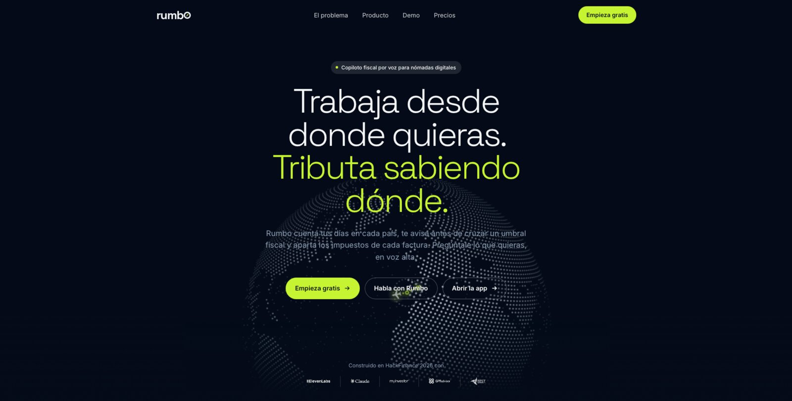
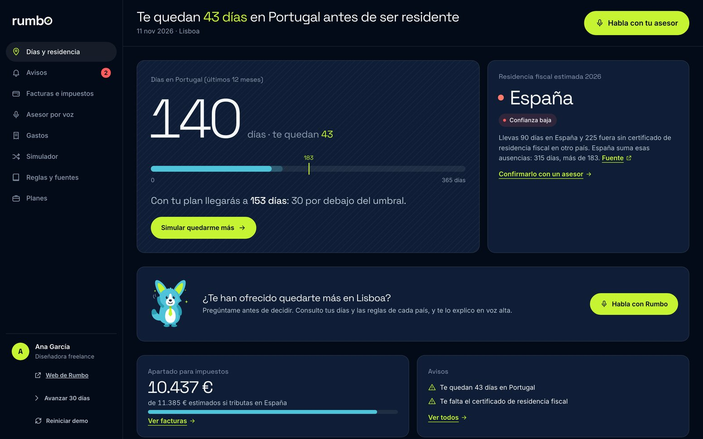
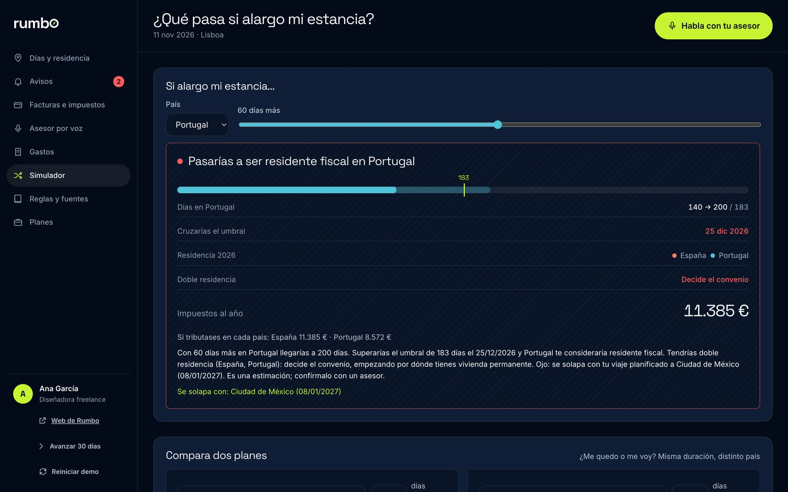
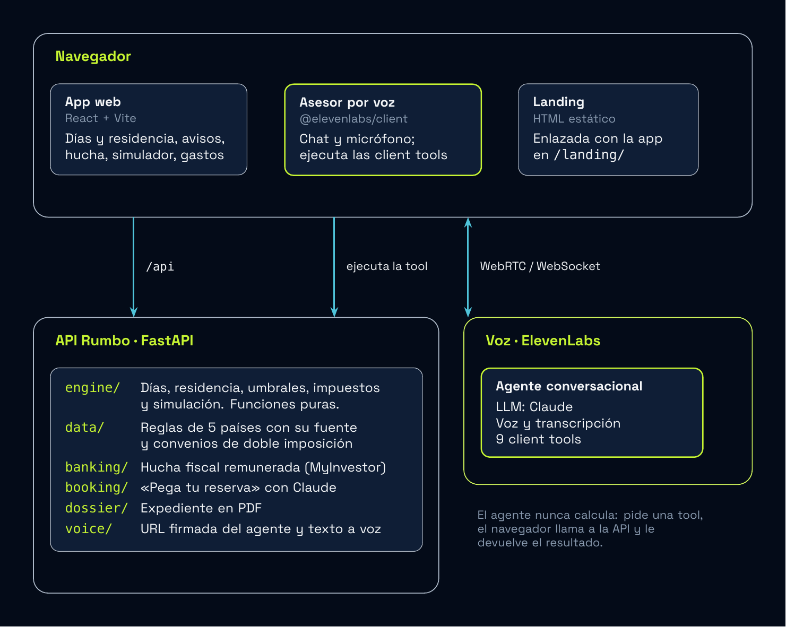

# rumbo

**Copiloto fiscal por voz para nómadas digitales.**
*Trabaja desde donde quieras. Tributa sabiendo dónde.*

Proyecto presentado a **HackFinance 2026** (BEST UC3M, Madrid Engineering Week).

Rumbo cuenta los días que pasas en cada país, te dice dónde eres residente fiscal este año, te avisa antes de cruzar un umbral y aparta los impuestos de cada factura. Y puedes preguntarle en voz alta: *"Me han ofrecido quedarme dos meses más en Lisboa. ¿Me afecta?"*



---

## Índice

1. [El problema](#el-problema)
2. [Qué hace Rumbo](#qué-hace-rumbo)
3. [Arquitectura](#arquitectura)
4. [Instalación](#instalación)
5. [Configuración](#configuración)
6. [Ejecución](#ejecución)
7. [Pruebas](#pruebas)
8. [Estructura del repositorio](#estructura-del-repositorio)
9. [Limitaciones conocidas](#limitaciones-conocidas)
10. [Línea roja y aviso legal](#línea-roja-y-aviso-legal)
11. [Equipo](#equipo)

---

## El problema

Un nómada digital sabe dónde trabaja, pero no dónde tributa. La residencia fiscal se decide **por año natural**, con reglas como los 183 días, el centro de intereses vitales y los convenios de doble imposición, y cada país las aplica a su manera. El resultado:

- **No sabe dónde es residente.** Puede acabar siéndolo en dos países a la vez, o creer que no lo es en ninguno (y que Hacienda le siga reclamando).
- **No sabe cuántos días le quedan.** Alargar una estancia unas semanas puede cambiarle la residencia sin que se dé cuenta.
- **No aparta lo que debe.** Cobra en varios países y no sabe cuánto reservar para impuestos.

Hoy esto se resuelve con hojas de cálculo, foros y una consulta cara a un asesor cuando ya es tarde.

## Qué hace Rumbo

| Pilar | Qué hace |
|---|---|
| **Rastrea** | Cuenta los días en cada país y estima dónde eres residente fiscal este año, con el motivo y el nivel de confianza. |
| **Avisa** | Te alerta antes de cruzar un umbral y cuando falta un documento (por ejemplo, el certificado de residencia fiscal). |
| **Aparta** | Con cada factura cobrada, reserva la parte de impuestos en una hucha fiscal remunerada. |
| **Responde por voz** | Un asesor por voz contesta con tus datos reales: días, residencia, simulaciones, hucha y avisos. También registra gastos dictados. |

Además:

- **Simulador:** "¿Qué pasa si me quedo 60 días más en Portugal?" Devuelve la nueva residencia, cuándo cruzas el umbral y la estimación por país.
- **Pega tu reserva:** pegas el email de un vuelo o un alojamiento y Rumbo extrae el viaje.
- **Expediente en PDF:** días por país, reglas aplicadas con su fuente y documentos que faltan, listo para llevar a un asesor.

| Días y residencia | Simulador |
|---|---|
|  |  |

Alcance del MVP: **5 países** (España, Portugal, México, Colombia y Tailandia) y una usuaria de demo, **Ana**, diseñadora freelance.

## Arquitectura



<sub>Fuente del diagrama: [`docs/diagramas/arquitectura.tex`](docs/diagramas/arquitectura.tex) (TikZ).</sub>

- **Client tools:** el agente pide al navegador que ejecute una herramienta (`simulate_stay`, `get_residency_status`, `register_expense`…). El navegador llama a la API, pinta el resultado en el chat y le devuelve el JSON al agente.
- **Agente privado:** la clave de ElevenLabs no sale del backend. El navegador recibe una URL firmada de un solo uso (`GET /api/voice/signed-url`).
- **Dinero:** importes en céntimos enteros y en la moneda original; las conversiones se hacen en una sola capa.
- **Reloj de demo inyectable:** nadie usa `date.today()` directamente, así que la demo cuenta la misma historia cualquier día.

## Instalación

Requisitos:

- **Python 3.11 o superior.** En macOS, `python3` puede ser una versión antigua: instala una nueva con `brew install python@3.12`.
- **Node.js 20 o superior** y npm.
- `make` (opcional; los comandos equivalentes están en [`backend/Makefile`](backend/Makefile)).

```bash
git clone https://github.com/nevambla/rumbo-hackfinance2026.git
cd rumbo-hackfinance2026

# Backend
cd backend
make install            # crea .venv, instala dependencias y copia .env.example a .env
                        # con otra versión de Python: make install PY=python3.12
cd ..

# Frontend
cd frontend
npm install
cd ..
```

## Configuración

**Todo es opcional.** Sin claves, la app funciona entera excepto el asesor por voz, y "Pega tu reserva" usa un extractor local.

Las variables van en `backend/.env` (plantilla en [`backend/.env.example`](backend/.env.example)). Si existe un `.env.local` en la raíz del repositorio, también se lee y tiene prioridad.

| Variable | Sin valor | Con valor |
|---|---|---|
| `ELEVENLABS_API_KEY` + `ELEVENLABS_AGENT_ID` | El asesor por voz muestra "Sin claves de ElevenLabs" | Activa el asesor por voz y la lectura de avisos con la voz del agente |
| `ANTHROPIC_API_KEY` | "Pega tu reserva" usa un extractor local | Extracción con Claude (`ANTHROPIC_MODEL`, por defecto `claude-sonnet-5-5`) |
| `DEMO_TODAY` | Fecha real | Fija el día de la demo (`AAAA-MM-DD`) |
| `CORS_ORIGINS` | Puertos 5173 y 3000 de localhost | Lista separada por comas, o `*` |

**Crear el agente de voz:** sigue [`backend/elevenlabs/agent.md`](backend/elevenlabs/agent.md). Tiene el prompt de sistema, el primer mensaje y las 9 herramientas listas para pegar en el panel de ElevenLabs. Las claves no están en el repositorio.

## Ejecución

En dos terminales:

```bash
# 1. API → http://localhost:8000  (Swagger en http://localhost:8000/docs)
cd backend && make dev

# 2. Web → http://localhost:5173
cd frontend && npm run dev
```

| Qué | URL |
|---|---|
| App | http://localhost:5173 |
| Landing | http://localhost:5173/landing/ |
| Documentación interactiva de la API | http://localhost:8000/docs |

La landing y la app se enlazan entre sí: el botón **«Abrir la app»** lleva a la app y el logo de la app lleva a la landing.

Para producción: `cd frontend && npm run build` genera `frontend/dist/`, con la landing copiada en `dist/landing/`.

**Antes de una demo**, reinicia los datos de Ana con el botón **«Reiniciar demo»** de la app o con `curl -X POST http://localhost:8000/api/demo/reset`.

## Pruebas

```bash
cd backend && make test
```

53 tests (pytest) que cubren:

- **Escenas de Ana:** las respuestas del guion de la demo, con las mismas cifras que dirá el agente.
- **Motor de reglas:** días por país, residencia, umbrales, desempates por convenio y simulaciones.
- **Dinero:** céntimos enteros y redondeos.
- **Fechas:** la historia de la demo es coherente en distintos días del año.
- **Contrato:** el esquema de `contract/openapi.json` coincide con el código.
- **Latencia:** las herramientas responden rápido, para que el agente no se quede callado.
- **Reglas sin verificar:** se listan las que aún no tienen fecha de verificación.


## Estructura del repositorio

```
.
├── backend/              API en Python (FastAPI): motor de reglas, datos y agente
│   ├── app/              engine/, banking/, booking/, dossier/, voice/, routers/
│   ├── data/             reglas por país, convenios, tramos y persona de demo
│   ├── contract/         openapi.json, client_tools.json y respuestas de ejemplo
│   ├── elevenlabs/       configuración del agente de voz
│   ├── tests/            tests de pytest
│   ├── API.md            guía de integración para el frontend
│   └── README.md         detalle del backend
├── frontend/             app web (React + Vite) conectada a la API y al agente
├── landing/              landing de venta (HTML estático, sin build)
├── docs/                 capturas y diagrama de arquitectura (fuente TikZ)
├── contexto.md           especificación del producto
```

## Limitaciones conocidas

Preferimos decirlas antes de que alguien las encuentre:

- **Las reglas fiscales están pendientes de verificar.** Todas tienen su `source_url`, pero `verified_at` vale `null` hasta contrastarlas con la fuente oficial. Por eso la confianza de la residencia sale "baja" y el agente recomienda confirmarlo con un asesor.
- **Los impuestos son estimaciones.** Los tramos de Portugal son provisionales; México, Colombia y Tailandia usan tipos efectivos de demo. Cada importe lleva la marca `is_estimate`.
- **Datos simulados.** Los viajes de Ana se cargan de un fichero; no hay geolocalización real. La cuenta remunerada es un **mock** de MyInvestor con un tipo de interés de demo, no una oferta real.
- **Una sola usuaria.** No hay cuentas ni base de datos; el estado se guarda en `backend/data/runtime/`.
- **Fuera del MVP:** pagos reales, conexión bancaria, presentación de impuestos y más de 5 países.

## Línea roja y aviso legal

- Rumbo planifica con **dónde vive el usuario de verdad**. No ayuda a fingir una residencia, ocultar ingresos ni montar estructuras ficticias; el agente se niega y ofrece alternativas legales.
- Rumbo es un **copiloto, no un asesor fiscal**. Sus resultados son estimaciones orientativas y, cuando el caso es complejo, deriva a un asesor.
- Avisa de las trampas en lugar de esquivarlas: no ser residente en ningún sitio no es una opción real, y una sociedad extranjera gestionada desde España puede acabar tributando en España.

## Equipo

**JustBuildIt**: seis estudiantes del doble grado en Ingeniería Informática y ADE de la UC3M.

- Manuel Nevado Blanco
- Alejandro Pérez Montes
- Daniel Robles Ruiz
- Lucas Ruiz Gómez
- Roberto Sanz Gamero
- Sofía Tejedor Alonso

---

Hecho por JustBuildIt en HackFinance 2026 con ElevenLabs, Claude y MyInvestor.
